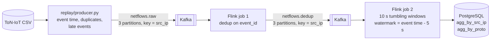

# netflow-streaming

Streaming pipeline for network flow data: the ToN-IoT network dataset is replayed as a live stream into **Kafka**, cleaned and aggregated in **Flink SQL** with event-time windows, and stored in **PostgreSQL**.

This project builds on my work on ML-based intrusion detection with network flows (ToN-IoT, Zeek features). The detection model worked on a static CSV; here the same flows arrive as an unordered, imperfect stream, which is the setting a live detector actually faces.

## Architecture



| Component | Role |
|---|---|
| `replay/producer.py` | Reads the CSV, assigns an event time, re-sends ~1 % of events (same `event_id`) and sends ~0.5 % of events 30 s late. Keyed by `src_ip`, so all flows of one host stay ordered in one partition. |
| `flink/sql/01_dedup.sql` | Keeps the first copy of each `event_id` (`ROW_NUMBER()` on processing time, state TTL 1 h). Append-only output to `netflows.dedup`. |
| `flink/sql/02_window_agg.sql` | Event-time tumbling windows of 10 s with a 5 s watermark. Per source IP: flows, attack flows, bytes in/out, distinct destination IPs and ports. Per protocol: flows, attack flows, bytes, mean duration. Events older than the watermark are dropped. |
| `postgres/init.sql` | Result tables. Primary key `(window_start, key)`: the JDBC sink upserts, so rewriting a window is idempotent. |

**Event time.** `train_test_network.csv` has no timestamp column, so the producer stamps each event with its send time, minus a random 0–3 s jitter to create out-of-order arrivals. That stays within the 5 s watermark tolerance, so jittered events are still counted. Events sent 30 s late are always behind the watermark, which makes the expected output exact. The producer saves the expected on-time count per window, and `bench/measure.py` checks Flink's output against it.

## Run it

Requires Docker (with Compose) and Python ≥ 3.10.

1. Download `train_test_network.csv` from the [ToN-IoT datasets page](https://research.unsw.edu.au/projects/toniot-datasets) (UNSW Canberra) into `data/`. The dataset is not redistributed here.
2. Start the stack and the pipeline:

```bash
make venv                          # Python environment
make up                            # Kafka (KRaft), PostgreSQL, Flink 1.19 — UI on http://localhost:8081
make jobs                          # submit the two Flink SQL jobs
make replay RATE=500 DURATION=120  # replay at 500 records/s for 120 s (DURATION=0: whole file)
make bench                         # completeness + latency report for the last run
make psql                          # e.g. SELECT * FROM agg_by_src_ip ORDER BY n_dst_ports DESC LIMIT 10;
```

## Tests

```bash
make test       # unit: row parsing, missing values, deterministic replay plan
make test-e2e   # end-to-end on the running stack: 20 events + 5 duplicates + 3 late
                # events must give exactly one window with 20 flows in PostgreSQL
```

## Measured results

Laptop with an Intel Core i7-12700H, Docker Engine inside WSL2 limited to 2 vCPUs and 3.8 GiB RAM. Each replay ran for 120 s (or until the dataset ended) with the default injection rates: 1 % duplicates, 0.5 % late events, 0–3 s jitter.

| | 500 records/s | 2,000 records/s |
|---|---|---|
| Records replayed | 60,001 | 211,043 (full dataset) |
| Duplicates / late events injected | 560 / 295 | 2,077 / 963 |
| Producer send rate (incl. duplicates) | 504.7 msg/s | 2,019.7 msg/s |
| Closed windows matching expected count | 11 / 11 | 10 / 10 |
| On-time events expected / counted | 53,118 / 53,118 | 183,318 / 183,318 |
| Window → PostgreSQL latency p50 | 6.80 s | 6.88 s |
| Window → PostgreSQL latency p95 | 8.39 s | 10.89 s |
| Window → PostgreSQL latency max | 11.76 s | 10.89 s |

Every closed window holds exactly the expected number of on-time events: duplicates were removed and late events dropped. Latency runs from the end of a window (event time) to its row in PostgreSQL and includes the 5 s watermark delay by design. Full reports are in `bench/results/`.

### A bug found by the benchmark

The first run at 2,000 records/s counted more events than were sent. Counting messages per Kafka topic showed that `netflows.dedup` held about 4.6 times more records than expected, so job 1 was re-emitting data. The Flink logs gave the cause: the dedup state had grown past 5 MiB, the limit of the default checkpoint storage (JobManager memory). Each time the state outgrew that limit, a checkpoint failed and the job restarted from the last checkpoint that fit; its at-least-once Kafka sink then wrote the same records again. The fix stores checkpoints on a filesystem volume shared by the JobManager and the TaskManager (`state.checkpoints.dir`).

## Limitations

- The dedup job writes to Kafka **at least once**. If job 1 fails and restarts, it can re-emit records that were not yet checkpointed, and job 2 would count them twice. Exactly-once would need Kafka transactions on that sink and `read_committed` on job 2's source.
- Dedup state is kept for 1 h: a copy arriving later than that is not detected.
- The last windows of a replay close only when newer events advance the watermark.
- Single broker, replication factor 1, parallelism 1: a local setup, not a production deployment.

## Next (V2)

Grafana dashboards on the PostgreSQL tables; anomaly detection on the per-IP windows (e.g. a host contacting many distinct ports).